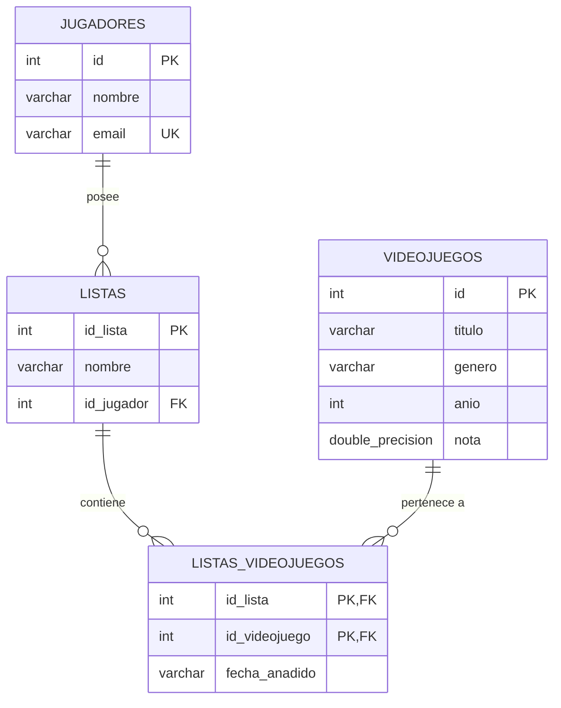

# Catálogo de Videojuegos con Base de Datos Relacional (UD3)

Aplicación de consola desarrollada en **Kotlin** con **Gradle** y **JDBC** para gestionar un catálogo de videojuegos, jugadores y listas personalizadas sobre **PostgreSQL**, aplicando el patrón arquitectónico **DAO (Data Access Object)** y transacciones **ACID**.

---

## 1. Estructura de la Base de Datos

La base de datos `videojuegos` está formada por **4 tablas** conectadas mediante Claves Primarias (**PK**) y Claves Foráneas (**FK**) con borrado en cascada (`ON DELETE CASCADE`):



* **`videojuegos`**: catálogo principal (`id`, `titulo`, `genero`, `anio`, `nota`).
* **`jugadores`**: usuarios propietarios de listas (`id`, `nombre`, `email` único).
* **`listas`**: listas creadas por un jugador (`id_lista`, `nombre`, `id_jugador` FK a `jugadores.id`).
* **`listas_videojuegos`**: tabla intermedia N:M que relaciona listas con videojuegos (`id_lista`, `id_videojuego`, `fecha_anadido`).

El script completo con la definición de tablas y los datos iniciales de prueba (5 videojuegos, 3 jugadores, 3 listas y asignaciones iniciales) se encuentra en [`datos/videojuegos.sql`](datos/videojuegos.sql).

---

## 2. Estructura del Código Kotlin

```text
src/main/kotlin/
├── ConexionBD.kt         --> Singleton JDBC para conectar contra PostgreSQL
├── Videojuego.kt         --> Modelo de datos (data class) de la tabla videojuegos
├── Jugador.kt            --> Modelo de datos (data class) de la tabla jugadores
├── Lista.kt              --> Modelo de datos (data class) de la tabla listas
├── ListaVideojuego.kt    --> Modelo de datos de la relación listas_videojuegos
├── VideojuegoDAO.kt      --> Operaciones CRUD completas sobre videojuegos
├── JugadorDAO.kt         --> Inserción, listado, comprobación y borrado transaccional de jugadores
├── ListaDAO.kt           --> Creación (validando jugador) y borrado de listas
├── ListaVideojuegoDAO.kt --> Inserción transaccional (autoCommit=false) y consulta con JOIN
└── Main.kt               --> Menú interactivo de consola dividido en 3 bloques
```

---

## 3. Instrucciones de Ejecución

### Requisitos previos
* **JDK 17 o superior** (proyecto configurado con Gradle y toolchain 24).
* **PostgreSQL** instalado y en ejecución en `localhost:5432`.

### Pasos para ponerlo en marcha
1. **Crear la base de datos en PostgreSQL** (desde **pgAdmin 4** o `psql`):
   ```sql
   CREATE DATABASE videojuegos;
   ```
2. **Cargar el esquema y los datos de prueba:**
   Abre el fichero [`datos/videojuegos.sql`](datos/videojuegos.sql) en la herramienta **Query Tool** de pgAdmin sobre la base de datos `videojuegos` y ejecútalo completo.
3. **Revisar credenciales en `ConexionBD.kt`:**
   Por defecto conecta a `jdbc:postgresql://localhost:5432/videojuegos` con el usuario `postgres` y contraseña `qwerty2`. Ajusta `USER` y `PASSWORD` en `src/main/kotlin/ConexionBD.kt` según la configuración de tu servidor PostgreSQL local (por ejemplo, `admin` en el equipo de clase).
4. **Compilar y ejecutar desde terminal o IntelliJ IDEA:**
   * En Windows:
     ```powershell
     .\gradlew.bat run
     ```
   * En Linux/macOS:
     ```bash
     ./gradlew run
     ```

---

## 4. Decisiones de Diseño

* **Elección de SGBD (PostgreSQL):** Se migró de SQLite a PostgreSQL modificando únicamente `build.gradle.kts` (driver `org.postgresql:postgresql`) y `ConexionBD.kt`, demostrando la independencia del patrón DAO frente al motor de base de datos.
* **Diseño de la tabla `jugadores`:** Se añadieron los campos `id` (`SERIAL PRIMARY KEY`), `nombre` y `email` (`UNIQUE NOT NULL`) para evitar registros de usuarios duplicados por correo.
* **Integridad referencial en cascada y transacciones:**
  * Las claves foráneas incorporan `ON DELETE CASCADE` y, además, `JugadorDAO.eliminarJugador` ejecuta explícitamente el borrado ordenado (`listas_videojuegos` → `listas` → `jugadores`) dentro de una transacción manual para garantizar consistencia total.
  * `ListaDAO.insertarLista` verifica primero la existencia del jugador antes de insertar la lista.
  * `ListaVideojuegoDAO.anyadirALista` agrupa en una transacción manual (`autoCommit = false`, `commit()` y `rollback()`) las comprobaciones `SELECT` de existencia de videojuego y lista junto al `INSERT` en `listas_videojuegos`.
* **Tipo numérico `DOUBLE PRECISION`:** Se utiliza `DOUBLE PRECISION` en PostgreSQL para `nota` de forma que corresponda exactamente con `Double` en Kotlin al leer con `ResultSet.getDouble`.
